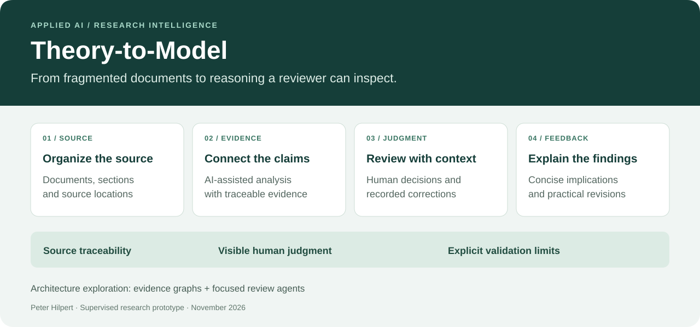
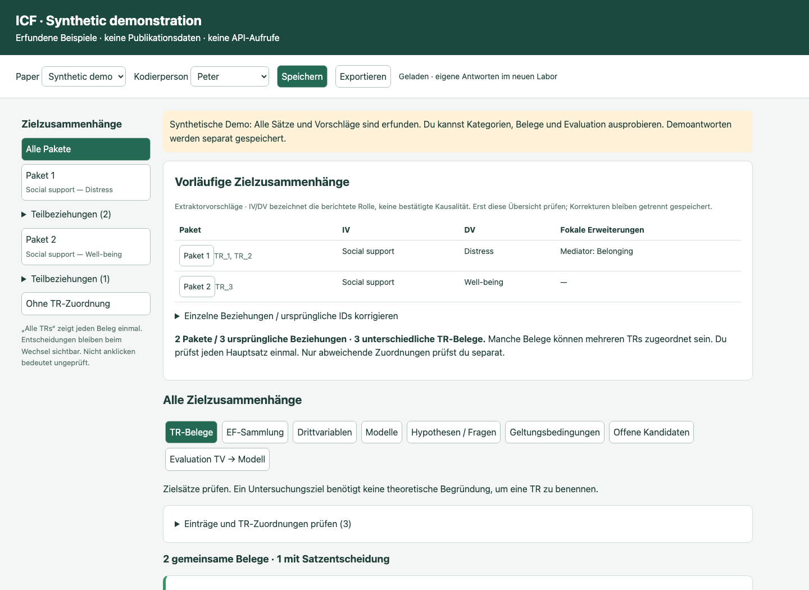
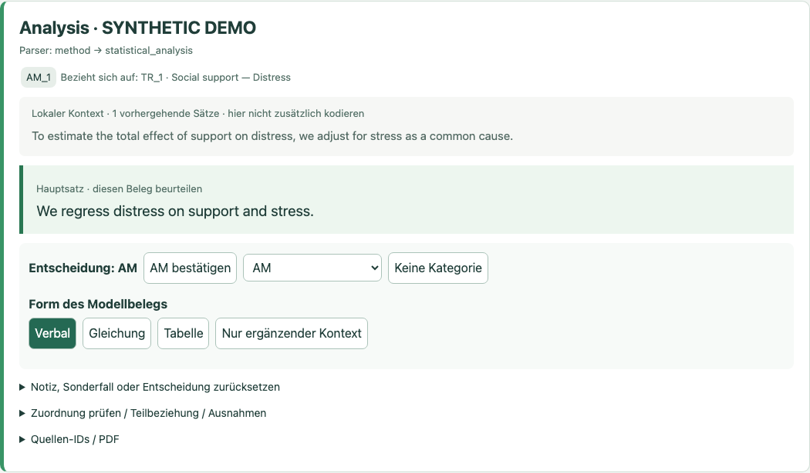
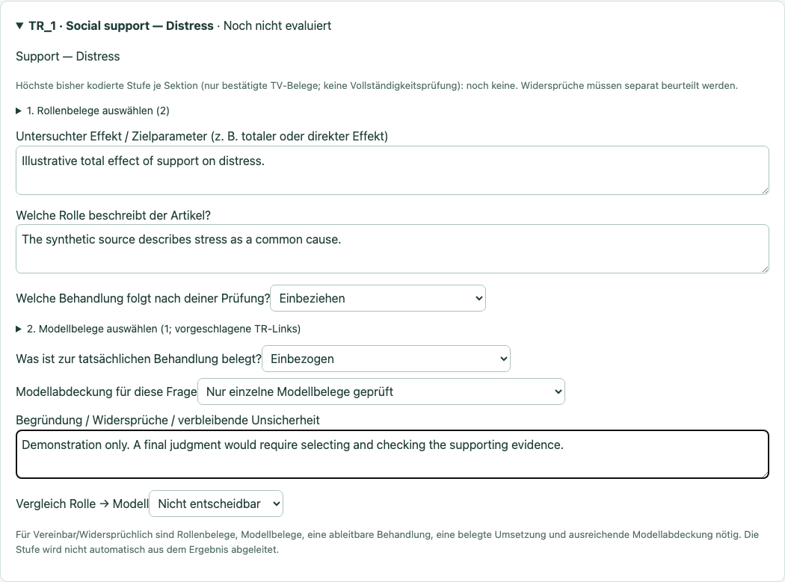

# Theory-to-Model — AI-Assisted Evidence Review

**Peter Hilpert · Applied AI project lead and domain architect**

Turning research publications into structured, source-linked evidence that a
human reviewer can inspect, correct and evaluate.

**Research prototype · Python + LLMs + browser-based review · September 2026**

## Inspect the work in five minutes

1. **Trace a claim:** read the [invented source](examples/source.txt) and its
   [evidence object](examples/evidence.json). The original suggestion and the
   correction are separate records.
2. **Verify the artifact:** run `python3 examples/verify_evidence.py` to check the
   actual source hash, text span and review link. No API key or dependencies.
3. **Inspect the workflow:** see the source-context and evaluation screenshots
   below, then the [observed error classes](docs/observed-errors.md).
4. **Check the limits:** [validation evidence](docs/validation-scope.md) separates
   tested software behavior from scientific benchmarking that is still pending.

## The problem

A scientific paper spreads its argument across prose, tables and statistical
models. Extracting plausible text is not enough: reviewers need to see where a
claim came from, whether context was lost, and how an automated suggestion was
corrected. Doing this one sentence at a time also creates substantial review
burden.

## What I built

I designed and developed a research pipeline combining document processing,
constrained LLM extraction and human review. Its current application examines
whether the theoretical argument in an observational study is consistent with
the reported statistical model.

This focused project addresses the theory-to-model gap within the broader ICF
research programme. It is not a presentation of the complete ICF framework.

The project covers publication retrieval and screening, PDF conversion,
cleaning, section parsing, evidence extraction, and a local review interface.
Reviewers can inspect source context, correct proposed categories, group shared
evidence and compare an article's stated rationale with its model description.

**My contribution:** scientific problem formulation, annotation-system design,
pipeline architecture, iterative error analysis and validation workflow. I used
AI-assisted implementation to turn those requirements into working software,
then refined the system through direct use and targeted tests.

## Engineering decisions that make the output reviewable

| Decision | Why it matters |
|---|---|
| Separate extraction from evaluation | A system must distinguish what an author says from whether the reasoning is coherent. |
| Preserve source references and artifact hashes | A reviewer can trace a claim back to the input that produced it. |
| Keep suggestions separate from human corrections | Corrections remain auditable without silently rewriting model output. |
| Use deterministic processing where practical | Structural repairs and validation can be tested without an LLM call. |
| Group shared evidence and review only changed regions | Reduce duplicate reading while retaining the original references. |
| Validate saving, conflicts and recovery | A review workflow must protect human work as well as generate suggestions. |

## See the prototype

*Screenshot of the working local interface, using entirely invented content.
The research interface is currently German. This is a demonstration, not a
benchmark result.*

The walkthrough has three stages: **target → source-context review → separate
model-coherence evaluation**. A correction is illustrated explicitly in the
[public JSON example](examples/evidence.json), with the original suggestion retained.

<strong>2. Inspect the source sentence and record a human decision</strong>

The highlighted sentence is read with its immediately preceding context. The
reviewer confirms or changes the category and records the relevant evidence form.
All text in this screenshot is invented.

<strong>3. Evaluate the reasoning separately from extraction</strong>

A synthetic example of the human-led evaluation screen. The judgment remains
“not decidable” while supporting evidence has not been fully checked. The entries
illustrate interaction with the prototype, not a research result or an automatic
causal judgment.

## What has been checked

The September handoff passed **46 synthetic pipeline regression tests**,
additional persistence and JavaScript checks, and browser tests covering demo
startup, saving and reloading decisions. Test cases address failure modes such
as citation abbreviations, section changes, duplicate evidence and stale writes.

See the [validation scope](docs/validation-scope.md) for what each type of check
supports, and the [error taxonomy](docs/observed-errors.md) for concrete failure
modes and remaining limits.

The prototype has also undergone iterative human review on a small development
set. That informed improvements; it does **not** establish an independent
accuracy or interrater-reliability estimate.

**Current boundary:** local research prototype. Hosted multiuser operation,
independent benchmarking and validation of the updated automatic evaluation
stage are future work. The current coherence-review interface is human-led.

## Applied AI capabilities demonstrated

Problem framing in a complex domain; document intelligence; constrained LLM
workflows; provenance-aware data modeling; human-in-the-loop product design;
regression testing; and explicit separation of technical verification from
scientific validation.

**Technology:** Python, Docling, OpenAI API, SQLite, versioned JSON artifacts,
HTML/CSS/JavaScript, pytest, unittest and browser automation.

## About this repository

This is a curated project showcase. The research implementation, prompts,
proprietary evaluation logic and datasets remain private. No executable
extraction pipeline, API credentials or publication content is distributed here.
The small public verifier checks only the illustrative artifact; it does not
expose extraction prompts, internal schemas or scientific scoring rules.

For a technical discussion or a guided demonstration, contact Peter Hilpert
through the application or profile accompanying this portfolio.
