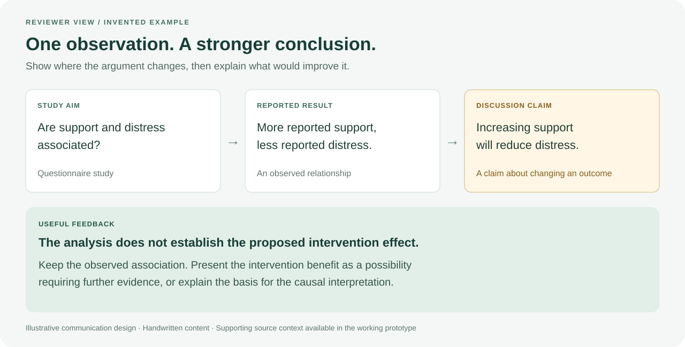

# A useful review explains the missing connection

**Entirely invented example.** This is a handwritten communication design, not
an automated result, a published study or the complete internal assessment method.

## The study as described

A questionnaire study examines whether perceived social support and distress
are associated. It reports that people describing more support also report less
distress. Its discussion recommends increasing support to reduce distress.

## The short reviewer note

**Finding:** the discussion moves from an observed association to an intervention
claim. The described analysis does not establish that increasing support would
reduce distress.

**Why it matters:** a difference between people does not by itself tell us what
would happen if we changed their circumstances. Other explanations can remain
compatible with the observed result.

**Suggested feedback to the authors:**

> Please distinguish the observed association from the proposed intervention
> effect. State that higher reported support was associated with lower distress,
> and frame the benefit of increasing support as a possibility requiring further
> evidence. If a causal interpretation is intended, explain the assumptions and
> study features that support it.

This note preserves the reported association while narrowing the unsupported
conclusion. It does not claim that support has no causal effect.

## Evidence on demand

In the working prototype, a reviewer can inspect the source passages supporting
the finding and the decisions made along the way. The first view should explain
the issue; supporting detail should be accessible without dominating it.

The general presentation is **finding → consequence → practical revision**, with
the source context available underneath. Its value still needs to be tested with
reviewers, including whether it helps them avoid unnecessary or incorrect criticism.
